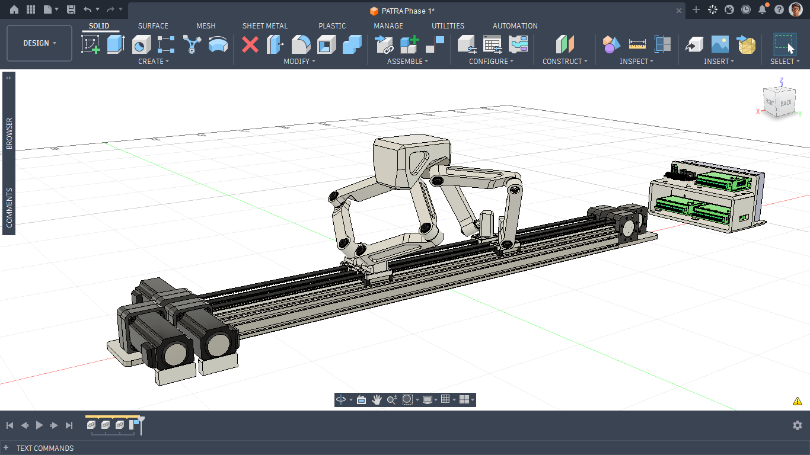
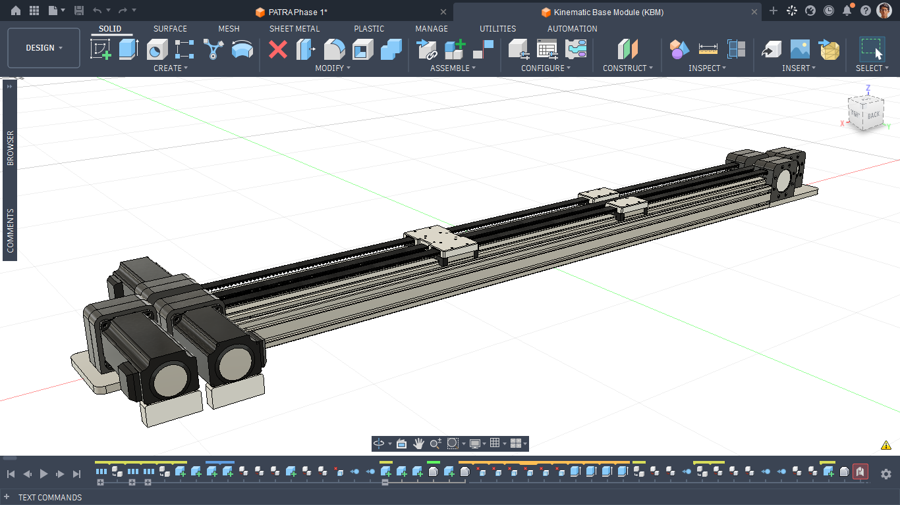
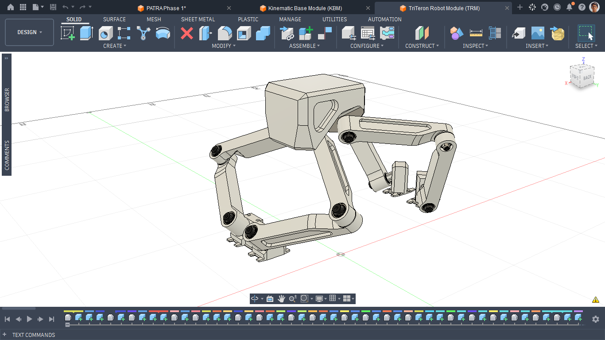
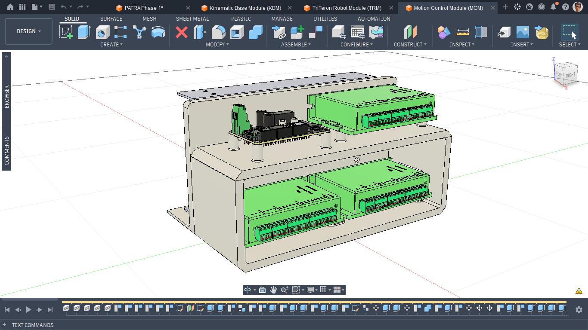
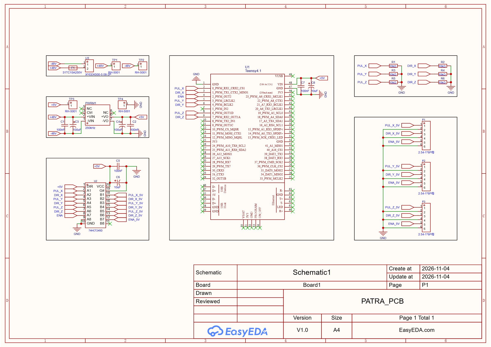
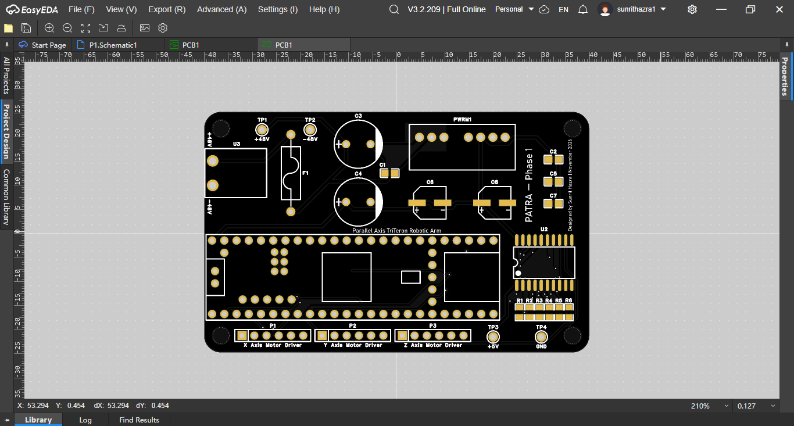
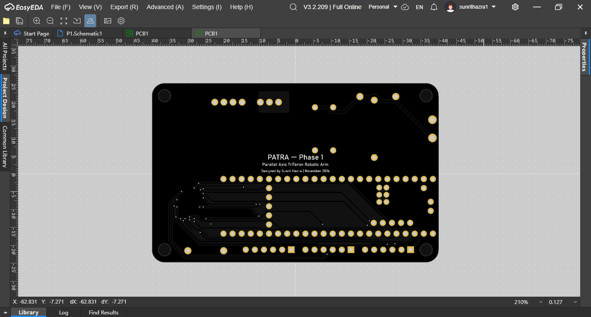
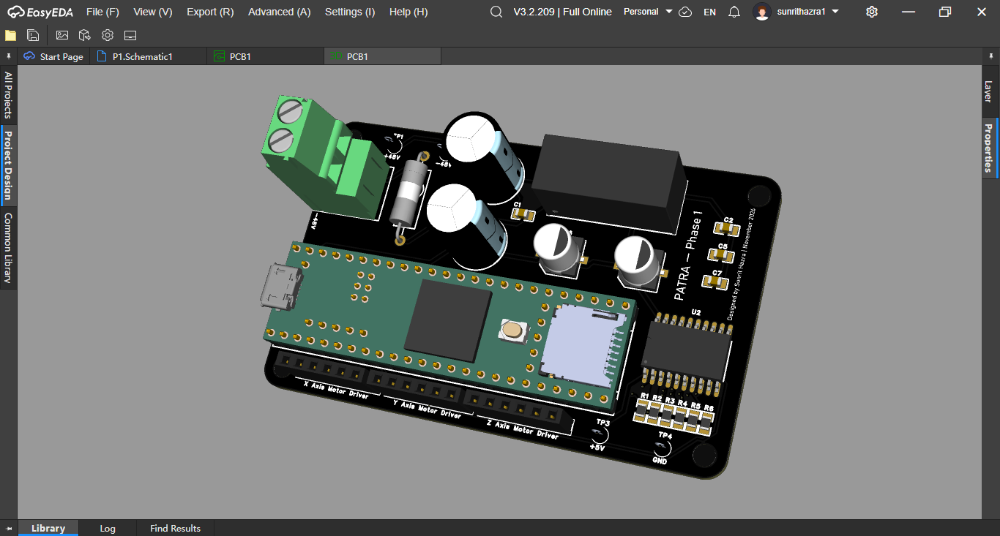

# PATRA: Phase 1

PATRA (Parallel Axis TriTeron Robotic Arm) is a nine-degree-of-freedom hybrid robotic system combining a three-degree-of-freedom (3-DOF) parallel manipulator with a six-degree-of-freedom (6-DOF) serial robotic arm. The system is designed to combine the workspace coverage of a parallel mechanism with the dexterity and orientation capabilities of a conventional robotic arm.



> [PATRA_Phase_1_Design_Journal.md](https://github.com/SunritHazra/PATRA-Parallel-Axis-TriTeron-Robotic-Arm/blob/main/Phase_1/PATRA_Phase_1_Design_Journal.md)  
> [PATRA_Phase_1_Build_Journal.md](https://github.com/SunritHazra/PATRA-Parallel-Axis-TriTeron-Robotic-Arm/blob/main/Phase_1/PATRA_Phase_1_Build_Journal.md)

This phase documents the parallel platform and its motion-control system, comprising the Kinematic Base Module (KBM), TriTeron Robot Module (TRM), and Motion Control Module (MCM). The serial robotic arm is planned for a later phase. This is an open-source robotics project by Sunrit Hazra, released under the [MIT licence][ref-licence] and developed as part of the **Hack Club Forge** YSWS program.

---

## Contents

1. [Project Overview](#1-project-overview)
2. [System Architecture](#2-system-architecture)
3. [Design and Verification](#3-design-and-verification)
4. [Manufacturing and Budget](#4-manufacturing-and-budget)
5. [Repository and Documentation](#5-repository-and-documentation)
6. [AI Assistance and Credits](#6-ai-assistance-and-credits)

---

## 1. Project Overview

### 1.1 Background

The idea began with a TriTeron video I found in December 2025. I later studied [Dan Rudmin's mechanism at Zaber Technologies][ref-rudmin] and [Rowan Hunt's carriage arrangement][ref-rowan]. I wanted to understand the mechanism well enough to build a version using affordable components and manufacturing methods available to me.

I started development on 10 April 2026. Since then, the work has involved considerably more than assembling purchased CAD models. I have redesigned housings, changed transmission choices, corrected mounting interfaces, and developed a dedicated controller carrier PCB.

### 1.2 Scope and Objectives

Phase 1 includes:

1. **KBM:** the structural frame, linear guides, belt drives, and carriage groups.
2. **TRM:** the linkage mechanism and moving tool head.
3. **MCM:** the controller PCB, motor drivers, power supply, and mounting case.

The objectives are to build a working translational prototype, test a **1 kg payload target**, and establish which parts need improvement before introducing machined components or a serial arm.

### 1.3 Principal Specifications

| Item | Current design |
| --- | --- |
| Mechanism | Parallel-axis TriTeron, three actuated translations |
| Payload | 1 kg target |
| Main profiles | Two 1,000 mm 4040 and two 1,135 mm 2020 extrusions |
| Guidance | Two 1,000 mm MGN15H rails and four blocks |
| Carriage groups | X, Y and Z; Z uses two linked blocks |
| Belts | 5 mm pitch, 15 mm width |
| X/Y transmission | 22-tooth pulleys, 1,067.5 mm nominal centre distance |
| Z transmission | 20-tooth pulleys, 1,202.5 mm nominal centre distance |
| X/Y motors | Two Rtelligent 57AM23ED, 2.3 N·m rated holding torque |
| Z motor | One Rtelligent 57AM30ED, 3 N·m rated holding torque |
| Motor drivers | Three Rtelligent T60 |
| Controller and supply | Teensy 4.1; Mean Well LRS-600-48 |
| Design tools | Autodesk Fusion and EasyEDA Pro |

### 1.4 Project Status

Phase 1 has been submitted to Hack Club Forge for review. This release covers the design and its supporting files. The physical build has not started, and no parts have been ordered. Nine bearing covers and twelve spacing washers have been printed. No completed RAM, measured positioning accuracy or demonstrated payload capacity is claimed here.

---

## 2. System Architecture

### 2.1 Kinematic Base Module (KBM)

The KBM provides the frame and independently driven carriage positions required by the TRM. All three actuator groups move along the parallel rail direction. The names X, Y, and Z identify those groups, not three perpendicular physical rails.



#### 2.1.1 Structure and Guidance

The frame uses MISUMI HFS5-4040-1000 and LCF6-2020-1135 profiles. Two MGN15H rails support four blocks: one for each X/Y carriage and two for the Z carriage. Printed support blocks connect the extrusions and support the motors and return-belt path.

The rail mounting arrangement includes backing pieces, inserts, and fasteners. The BOM includes fifty M3×8 mm inserts and fifty M3×12 mm socket-head screws for the rail-related fastening. Shielding is divided into ten sections with eight joining components rather than being printed as two metre-long pieces.

#### 2.1.2 Transmission

Each actuator has a motor-driven pulley, an idler and a cut belt secured to the carriage by a clamp. The purchased belts are 2,250 mm stock for X/Y and 2,600 mm stock for Z. Their nominal installed pitch-path lengths are shorter; the purchased lengths are deliberate cutting stock.

The assemblies use twelve 6901ZZ bearings, custom pulley and idler shafts, printed housings, covers, and spacing washers. The current BOM assigns the shafts to MJF PA12S-HP nylon and the main housings to PETG-CF.

#### 2.1.3 Extrusion Fastening

Four M3×45 mm screws and four custom-printed washers form the brace-fastening arrangement. The screw seats are inside the extrusion channels, not on the outermost profile faces. The geometry requires tapped holes in the mating profiles.

#### 2.1.4 Return-Belt Protection

UHMW tape is specified over the relevant support surfaces. Its 10 mil thickness is 0.254 mm. The sampled clearance leaves approximately 0.348 mm after one nominal tape layer, before other manufacturing and assembly effects.

### 2.2 TriTeron Robot Module (TRM)

The TRM connects the three carriage groups to one tool head. Its joint-axis arrangement is intended to permit translation while constraining head rotation.



#### 2.2.1 Linkage Arrangement

There are four physical two-link branches: X, Y, Z-A and Z-B. Together they contain eight links and twelve revolute joints. The two Z branches share one actuator group; they do not add a fourth independently driven axis.

#### 2.2.2 Bearings and Fasteners

The pivot assemblies use twenty-four 608ZZ bearings, twelve MISUMI MSB8-30 shoulder screws, twelve DIN 982 M6 nuts and twenty-four M8 washers. Four printed distal-joint spacers are included separately. Each pivot uses two bearings.

#### 2.2.3 Interfaces

The X and Y mounts connect to the KBM clamp interfaces through their internal mounting pieces. The paired Z linkage attaches to its own mount. The tool head brings the branches together and provides the platform for later fixtures or the RAM.

The bearing seats have a nominal 22.2 mm diameter for 22 mm bearings. That provides a modelled fit allowance, not a guarantee of the fit produced by a particular printer.


### 2.3 Motion Control Module (MCM)

The MCM contains the power and control hardware needed to operate the three actuators, with a mounting arrangement that leaves the connectors accessible.



#### 2.3.1 Power and Drivers

A Mean Well LRS-600-48 supplies the system's 48 V rail. Three Rtelligent T60 drivers operate the closed-loop stepper motors. The T60 supports up to 68 VDC.

Motor encoder feedback closes the motor-driver loop. It does not directly measure tool-head position or correct belt stretch, linkage compliance or backlash. The prototype has no automatic homing, so it relies on a manually set reference position and bounded motion commands.

#### 2.3.2 Controller PCB

The 80 mm by 50 mm, two-layer board was designed in EasyEDA Pro around a Teensy 4.1. It includes an isolated URB4805S-3WR3 converter, a 74HCT245D interface, local decoupling, six signal pull-down resistors, input protection, test points, and three driver headers.

The Teensy is supplied from the 5 V logic power rail, but its GPIO signals are 3.3 V. The HCT interface provides the 5 V driver-side signals.

| Function | Teensy GPIO | Driver interface |
| --- | --- | --- |
| X pulse / direction | 0 / 1 | P1 |
| Y pulse / direction | 3 / 4 | P2 |
| Z pulse / direction | 6 / 7 | P3 |
| Shared enable | 2 | All three interfaces |

Each six-pin driver interface carries pulse positive/negative, direction positive/negative, and enable positive/negative. The PCB separates the 48 V input domain from the isolated logic domain; its copper keepouts were part of the layout work.

The schematic is arranged in six blocks. The 48 V supply enters through a two-way terminal and a fuse, with a test point on each rail. The isolated converter produces the 5 V logic rail, with 100 nF and 100 µF capacitors on its input and output. The Teensy 4.1 generates the pulse, direction and enable signals, and the 74HCT245D buffers them to 5 V. Six 10 kΩ resistors pull the pulse and direction lines to ground. Three six-pin headers carry the 5 V signals to the drivers, with their negative pins tied to logic ground.









#### 2.3.3 Case and Mounting

The case is divided into three printable bodies, with locating features and clearance for assembly. The fastener selection uses sixteen M3×10 mm inserts and matching screws for the drivers and PCB, plus four M4×20 mm countersunk screws for the PSU.

The PCB insert pockets are 10 mm deep, and the drivers mount with M3 screws. The case layout allows for connector access, screw access and component spacing.

---

## 3. Design and Verification

### 3.1 Belt Geometry and Pretension

#### 3.1.1 Nominal Pitch Path

For two equal pulleys, the nominal pitch-path length is:

```math
L=2C+zp
```

Here, $`C`$ is centre distance, $`z`$ is the tooth count of one pulley and $`p`$ is belt pitch.

```math
\begin{aligned}
L_{XY}&=2(1067.5)+22(5)=2245\ \mathrm{mm},\\
L_Z&=2(1202.5)+20(5)=2505\ \mathrm{mm}.
\end{aligned}
```

These correspond to 449 and 501 nominal 5 mm pitches. I adjusted the housing geometry to obtain those nominal paths; the rails remained 1,000 mm long.

The calculation describes the reference path, not an instruction to purchase factory-endless belts of exactly those lengths. The actual design uses cut stock retained by clamps, and integer pitch counts alone do not establish pretension.

#### 3.1.2 Fixed-Gap Clamp Principle

Separate parametric clamp templates are kept alongside the installed clamps. Their `FG_XY_Gap` and `FG_Z_Gap` parameters set the separation across the cut belt ends, and both start at 5 mm. The templates have not been physically tested.

For a fixed pitch path $`P`$, retained tooth count $`N`$ and separation $`d`$ between the tooth centres across the cut, the nominal take-up can be represented by:

```math
\delta=P-\left[(N-1)p+d\right],
\qquad
\Delta\delta=-\Delta d-p\Delta N.
```

At an unchanged tooth count, reducing the centre gap increases the extension required from the belt. For example, reducing a 5 mm reference gap to 4.5 mm gives $`\Delta\delta=5.0-4.5=0.5\,\mathrm{mm}`$ additional geometric take-up. This is not a specified tension force.

The tooth pitch inside each intact gripping section stays unchanged. The cut faces must still clear each other, the clamps must retain enough engaged teeth, and the cords must not be damaged. Adding teeth is not automatically a way to increase tension.

### 3.2 Carriage-to-Head Kinematics

#### 3.2.1 Coordinate Convention

In the recorded CAD analysis, the rails run along world X. The vector $`\mathbf{q}`$ contains the three carriage coordinates; $`\mathbf{p}`$ contains the Cartesian tool-head coordinates.

For one linkage chain with parallel revolute axes along the unit vector $`\mathbf{n}_i`$, the projected displacement constraint is:

```math
\mathbf{n}_i^T\Delta\mathbf{p}
=n_{ix}\Delta q_i.
```

Stacking the three independent actuator constraints gives:

```math
N\Delta\mathbf{p}=D\Delta\mathbf{q},
\qquad
J=N^{-1}D,
\qquad
D=\operatorname{diag}(n_{Xx},n_{Yx},n_{Zx}).
```

Here $`N`$ contains the three joint-axis vectors as rows. The extra Z branch adds physical constraints but not another actuator coordinate.

#### 3.2.2 Recorded Numerical Result

Vector extracted the axes from the inspected CAD configuration and obtained approximately:

```math
J\approx
\begin{bmatrix}
0.249995 & 0.250005 & 0.500000\\
0.353143 & -0.353143 & 0\\
-0.249995 & -0.250005 & 0.500000
\end{bmatrix},
\qquad
\Delta\mathbf{p}=J\Delta\mathbf{q}.
```

The inverse relationship is approximately:

```math
\begin{aligned}
\Delta q_X&=\Delta x+1.415888\Delta y-\Delta z,\\
\Delta q_Y&=\Delta x-1.415830\Delta y-\Delta z,\\
\Delta q_Z&=\Delta x+\Delta z.
\end{aligned}
```

| Desired head displacement | X carriage | Y carriage | Z carriage |
| --- | ---: | ---: | ---: |
| 10 mm in positive Cartesian X | 10 mm | 10 mm | 10 mm |
| 10 mm in positive Cartesian Y | 14.1589 mm | -14.1583 mm | Approximately 0 mm |
| 10 mm in positive Cartesian Z | -10 mm | -10 mm | 10 mm |

These are calculated movements, not recorded physical tests. Absolute positioning also needs a reference pose:

```math
\mathbf{p}=\mathbf{p}_0+J(\mathbf{q}-\mathbf{q}_0).
```

The matrix's calculated condition number was approximately 1.416. This describes the conditioning of the inspected translational mapping, not a measured accuracy or proof that every possible linkage configuration is free of singularities.

### 3.3 Mobility and Load Calculations

#### 3.3.1 Instantaneous Mobility

The numerical rigid-body model contains twelve moving bodies: three carriage groups, eight links and the head. Their instantaneous velocities give 72 unknowns. Twelve revolute and three prismatic joints contribute 75 constraint rows.

The recorded constraint-matrix result was:

```math
C\in\mathbb{R}^{75\times72},
\qquad
\operatorname{rank}(C)=69,
\qquad
M=72-69=3.
```

Locking the three carriage coordinates raised the rank to 72, leaving no instantaneous mobility. The calculation used metre-scaled joint coordinates and a numerical rank tolerance of $`10^{-8}`$. It supports the intended three-DOF mechanism at the inspected configuration; it is not a dynamic simulation or a physical binding test.

#### 3.3.2 Payload-Only Force Example

Using virtual work, the actuator-force relationship is:

```math
\mathbf{F}_q=J^T\mathbf{F}_p.
```

For an ideal upward support force corresponding to a 1 kg payload:

```math
\mathbf{F}_p=
\begin{bmatrix}0\\0\\9.80665\end{bmatrix}\ \mathrm{N}
\quad\Rightarrow\quad
\mathbf{F}_q\approx
\begin{bmatrix}-2.4516\\-2.4517\\4.9033\end{bmatrix}\ \mathrm{N}.
```

The signs follow the chosen actuator directions. This example excludes linkage and fixture weight, friction, acceleration, transmission losses and belt pretension. It is not a complete motor-sizing calculation or evidence that the prototype has carried 1 kg.

### 3.4 Travel Limits and Workspace

The 1,000 mm rail and 58.8 mm block length give the nominal single-block centre travel:

```math
s=1000-58.8=941.2\ \mathrm{mm}.
```

For a rail centred at world-X zero, with a joint positive along world X and its reference block centre at $`x_0`$:

```math
q_{\min}=-470.6\ \mathrm{mm}-x_0,
\qquad
q_{\max}=470.6\ \mathrm{mm}-x_0.
```

Reversed joint directions require reversed signs. Shared-rail carriage separation, mounts, housing clearance, linkage folding and cables further restrict usable motion. I added slider and revolute limits, but a full collision-qualified Cartesian workspace remains a physical and motion-validation task.

### 3.5 CAD Checks and Their Scope

The journal records successive checks, corrections, and rechecks rather than one final certification run.

| Area | Work recorded |
| --- | --- |
| KBM | Selected interference checks, shaft fits, support-hole checks, belt clearance and fastener review |
| TRM | Bearing-axis alignment, assembly joints, seat clearances, interface registration and motion limits |
| MCM | Primary-body interference, insert pockets, component mounting and connector access |
| PCB | Repeated DRC and manufacturing checks during layout, as recorded in the journal |

Earlier scoped static checks found no overlap among eighteen selected TRM printed bodies or eight selected MCM primary bodies at their inspected poses. Hardware placement problems were separately identified and corrected. Those results do not constitute a fresh sweep of every body through the entire v2 workspace.

No completed structural FEA, thermal simulation, fatigue analysis or physical performance testing is claimed. The numerical work here is kinematic and analytical, while the Fusion work is geometric and joint-based.

---

## 4. Manufacturing and Budget

### 4.1 Materials and Processes

| Parts | Current BOM material or process |
| --- | --- |
| Pulley/idler case halves and lower belt clamps | FDM PETG-CF, black |
| TRM links, mounts and head; upper clamps, shields and end plates | FDM PLA PRO, silver |
| Motor/extrusion supports, distal spacers, brace washers and MCM case | FDM PLA PRO, white |
| Bearing covers and spacing washers | FDM PETG, white |
| Three pulley shafts and three idler shafts | MJF PA12S-HP nylon |
| Frame, guides, bearings, belts and fasteners | Purchased hardware |
| Controller board | PCB fabrication followed by assembly |

I use an Elegoo Centauri Carbon for home printing. Final orientation, supports, wall count, infill, and fit compensation will be documented during fabrication rather than presented as already validated settings.

### 4.2 Procurement Summary

| Category | Latest estimate, USD | Allocation, USD |
| --- | ---: | ---: |
| KBM | 567.58 | 575.00 |
| TRM | 16.05 | 25.00 |
| MCM | 222.52 | 250.00 |
| Miscellaneous, filament, shipping and taxes | 125.96 | 150.00 |
| **Total** | **932.12** | **1,000.00** |

The total follows the supplied BOM's underlying values; displayed subtotal rounding can differ by some cents. The figures are estimates, not expenditures. Blank costs against home-printed parts do not mean that printing is free: filament is budgeted separately, and machine time and failed prints are not comprehensively costed.

---

## 5. Repository and Documentation

### 5.1 Release Organisation

| Location | Contents |
| --- | --- |
| [BOM][ref-bom] | Procurement spreadsheet and tabular export |
| [CAD][ref-cad] | Module folders, retained print geometry and combined assembly |
| [Drawings][ref-drawings] | Available leg drawing and reference image |
| [PCBA][ref-pcba] | EasyEDA source, schematic image, Gerbers, PCB BOM and STEP references |
| [Main journal][ref-journal] | Full development record, including release preparation |
| [Phase design journal][ref-design-journal] | Phase-specific design record |
| [Phase build journal][ref-build-journal] | Reserved for fabrication, assembly and testing |

### 5.2 CAD Versions and Print Exports

| Module | Revision | Export formats |
| --- | --- | --- |
| [KBM][ref-kbm-cad] | v12 | Native Fusion archive, STEP and 3MF geometry |
| [TRM][ref-trm-cad] | v10 | Native Fusion archive, STEP and 3MF geometry |
| [MCM][ref-mcm-cad] | v5 | STEP and three 3MF case bodies |
| Combined Phase 1 | v2 | STEP and USDZ |

The 3MF files contain printed parts only. Quantities and materials follow the BOM.

### 5.3 Git LFS

The KBM v12 native Fusion archive and the combined Phase 1 v2 STEP assembly are stored with [Git LFS][ref-lfs]. Install Git LFS and pull the LFS objects before opening them; without it, they download as small text pointer files.

### 5.4 Documentation to Be Added

| Section | Planned content |
| --- | --- |
| Fabrication | Validated print settings, fit coupons, and machining instructions |
| Assembly | Illustrated module and full-system assembly sequence |
| Electrical integration | Wiring schedule, connector pinouts and commissioning record |
| Software | Firmware source, dependencies, configuration and operating procedure |
| Calibration | Manual reference, axis signs and motion conversion checks |
| Testing | Payload, repeatability, stiffness, temperature and workspace measurements |

---

## 6. AI Assistance and Credits

### 6.1 AI Assistance

I used ChatGPT, Claude, Grok, Gemini, Google AI, and Vector for research, explanations, calculation review, and documentation. Vector inspected Fusion geometry, assisted with the kinematic and mobility calculations, identified mechanical discrepancies, and created the parametric clamp templates. Google AI helped with the Git LFS upload workflow. This README was polished with AI assistance from the journal, CAD-review records, and my latest updates.

I did not accept every suggestion. I checked or corrected findings, retained decisions I had already verified, and deferred changes that made more sense during assembly. The calculations above are analytical results, not AI-generated evidence of a physical test. A [recorded Vector discussion][ref-vector-review] is linked in the journal.

### 6.2 Credits

I acknowledge **Dan Rudmin of Zaber Technologies** and **Rowan Hunt of Not An Engineer** for the reference mechanisms and discussions that shaped PATRA. I also thank **Zisheng Li of Anvol**, **Annie of OmniSim**, **Jeff of Vector**, and **Hack Club Forge** for the assistance and opportunities recorded in the journal.

### 6.3 Licence

PATRA is open source under the **MIT licence**, copyright 2026 Sunrit Hazra. The [repository licence][ref-licence] gives the terms.

[ref-bom]: https://github.com/SunritHazra/PATRA-Parallel-Axis-TriTeron-Robotic-Arm/tree/main/Phase_1/BOM
[ref-build-journal]: https://github.com/SunritHazra/PATRA-Parallel-Axis-TriTeron-Robotic-Arm/blob/main/Phase_1/PATRA_Phase_1_Build_Journal.md
[ref-cad]: https://github.com/SunritHazra/PATRA-Parallel-Axis-TriTeron-Robotic-Arm/tree/main/Phase_1/CAD
[ref-design-journal]: https://github.com/SunritHazra/PATRA-Parallel-Axis-TriTeron-Robotic-Arm/blob/main/Phase_1/PATRA_Phase_1_Design_Journal.md
[ref-drawings]: https://github.com/SunritHazra/PATRA-Parallel-Axis-TriTeron-Robotic-Arm/tree/main/Phase_1/Drawings
[ref-journal]: https://github.com/SunritHazra/PATRA-Parallel-Axis-TriTeron-Robotic-Arm/blob/main/JOURNAL.md
[ref-kbm-cad]: https://github.com/SunritHazra/PATRA-Parallel-Axis-TriTeron-Robotic-Arm/tree/main/Phase_1/CAD/Kinematic_Base_Module
[ref-lfs]: https://docs.github.com/en/repositories/working-with-files/managing-large-files/about-git-large-file-storage
[ref-licence]: https://github.com/SunritHazra/PATRA-Parallel-Axis-TriTeron-Robotic-Arm/blob/main/LICENSE
[ref-mcm-cad]: https://github.com/SunritHazra/PATRA-Parallel-Axis-TriTeron-Robotic-Arm/tree/main/Phase_1/CAD/Motion_Control_Module
[ref-pcba]: https://github.com/SunritHazra/PATRA-Parallel-Axis-TriTeron-Robotic-Arm/tree/main/Phase_1/PCBA
[ref-rowan]: https://www.youtube.com/watch?v=io4S9amExNM
[ref-rudmin]: https://www.youtube.com/watch?v=6EtXycVGJg4
[ref-trm-cad]: https://github.com/SunritHazra/PATRA-Parallel-Axis-TriTeron-Robotic-Arm/tree/main/Phase_1/CAD/TriTeron_Robot_Module
[ref-vector-review]: https://heyvector.co/share/3f6e24fe55da2a9958d2f134c3ad7ea6
