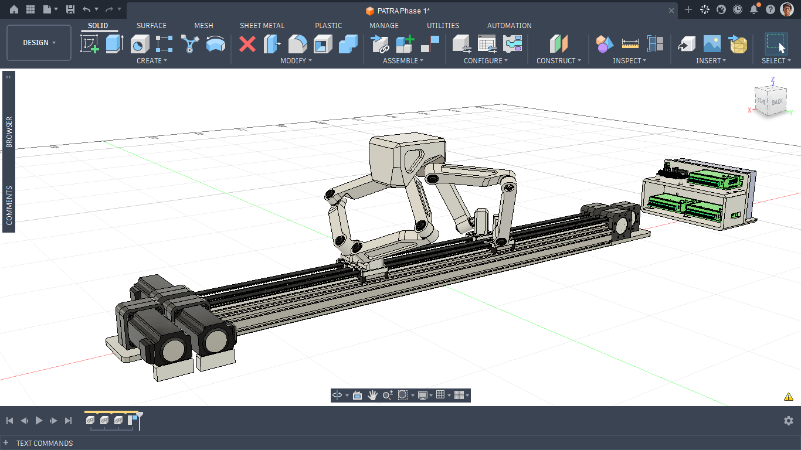
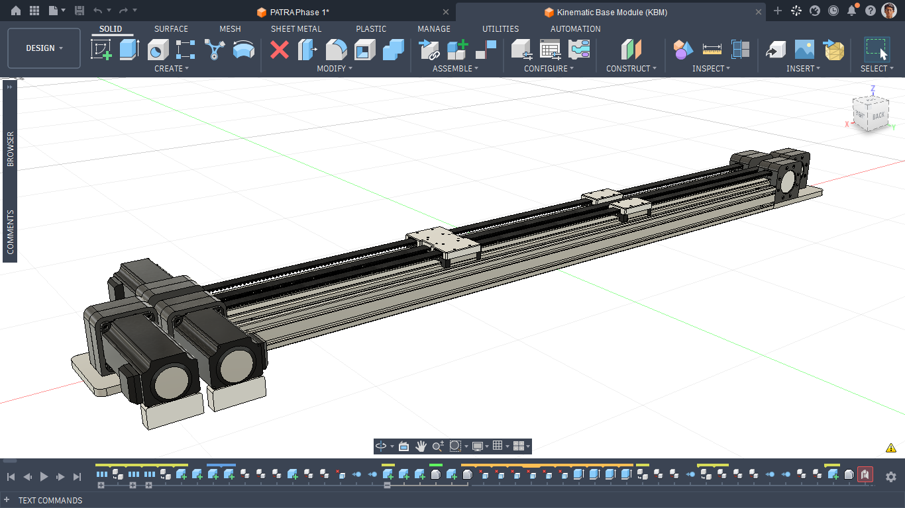
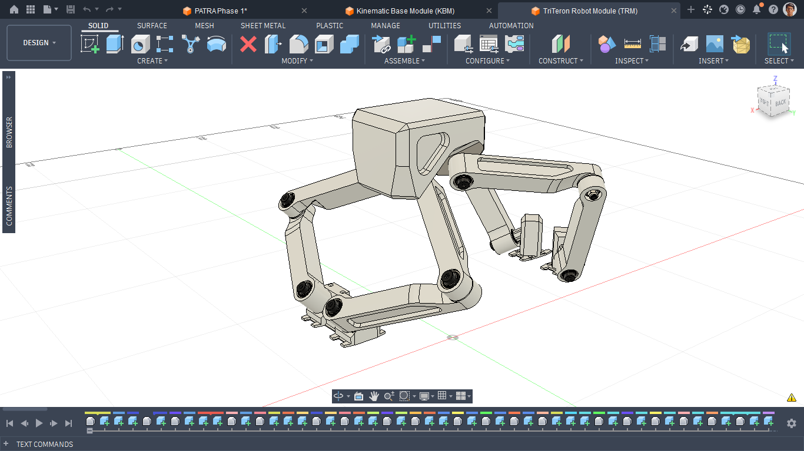
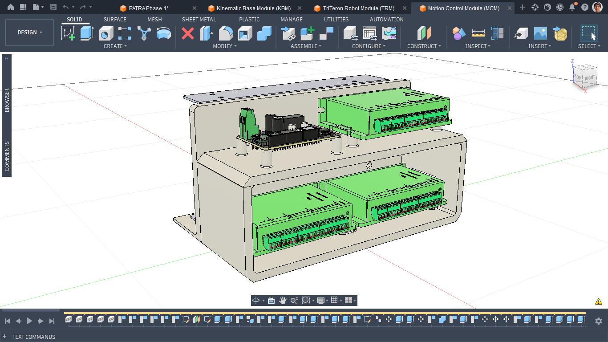
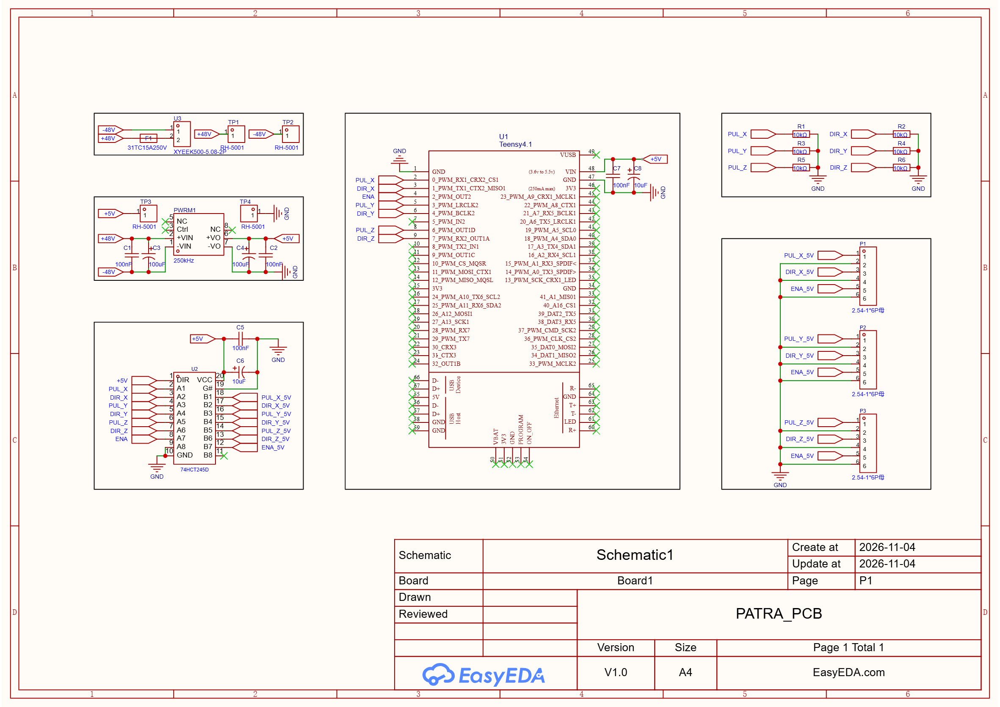
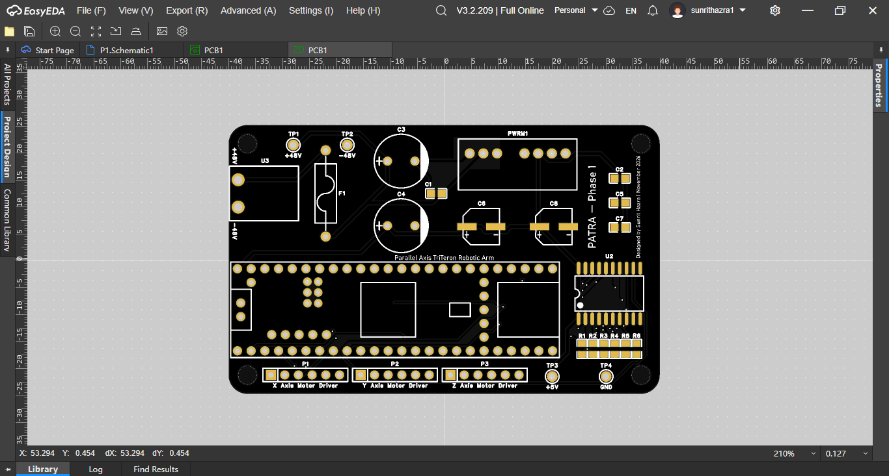
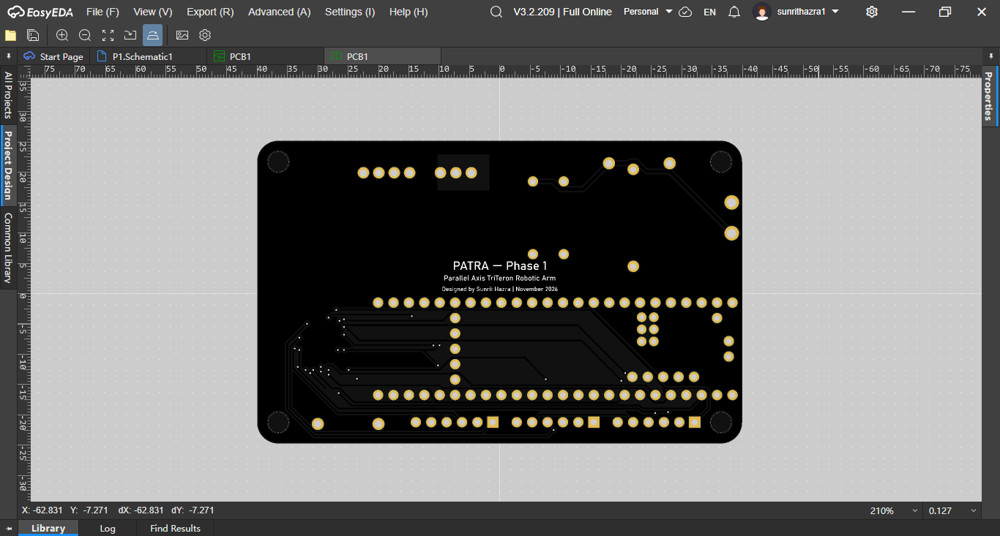
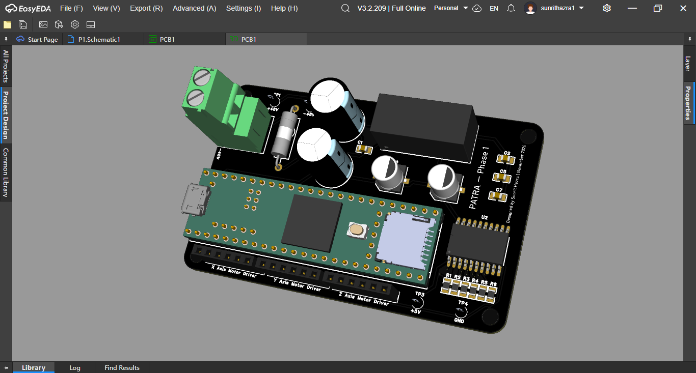

# PATRA

PATRA (Parallel Axis TriTeron Robotic Arm) is a nine-degree-of-freedom hybrid robotic system combining a three-degree-of-freedom (3-DOF) parallel manipulator with a six-degree-of-freedom (6-DOF) serial robotic arm. The system is designed to combine the workspace coverage of a parallel mechanism with the dexterity and orientation capabilities of a conventional robotic arm.

> [JOURNAL.md](https://github.com/SunritHazra/PATRA-Parallel-Axis-TriTeron-Robotic-Arm/blob/main/JOURNAL.md)
> [Phase_1/README.md](https://github.com/SunritHazra/PATRA-Parallel-Axis-TriTeron-Robotic-Arm/blob/main/Phase_1/README.md)

PATRA is developed in three phases. Phase 1, the parallel platform and its motion-control system, is the current phase. The serial robotic arm is planned for a later phase. This is an open-source robotics project by Sunrit Hazra, released under the [MIT licence][ref-licence] and developed as part of the **Hack Club Forge** YSWS program.

---

## Contents

1. [Project Overview](#1-project-overview)
2. [System Architecture](#2-system-architecture)
3. [Development Phases](#3-development-phases)
4. [Repository](#4-repository)
5. [AI Assistance and Credits](#5-ai-assistance-and-credits)

---

## 1. Project Overview

### 1.1 Background

The idea began with a TriTeron video I found in December 2025. I later studied [Dan Rudmin's mechanism at Zaber Technologies][ref-rudmin] and [Rowan Hunt's carriage arrangement][ref-rowan]. I wanted to understand the mechanism well enough to build a version using affordable components and manufacturing methods available to me. I started development on 10 April 2026.

### 1.2 Concept

A conventional seventh axis moves a robotic arm along one additional rail. PATRA places the arm on a three-axis parallel platform, so the platform positions the arm in X, Y and Z before the arm's own joints move. The complete architecture has nine actuated degrees of freedom: three from the platform and six from the arm.

### 1.3 Principal Specifications

| Item | Phase 1 design |
| --- | --- |
| Mechanism | Parallel-axis TriTeron, three actuated translations |
| Payload | 1 kg target |
| Guidance | Two 1,000 mm MGN15H rails and four blocks |
| Belts | 5 mm pitch, 15 mm width |
| Motors | Two Rtelligent 57AM23ED and one 57AM30ED closed-loop steppers |
| Motor drivers | Three Rtelligent T60 |
| Controller and supply | Teensy 4.1; Mean Well LRS-600-48 |
| Design tools | Autodesk Fusion and EasyEDA Pro |

### 1.4 Project Status

Phase 1 has been submitted to Hack Club Forge for review. The physical build has not started, and no parts have been ordered. Phases 2 and 3 have not started. No measured positioning accuracy or demonstrated payload capacity is claimed here.

---

## 2. System Architecture

### 2.1 Kinematic Base Module (KBM)

The KBM is the fixed base. It uses 4040 and 2020 aluminium extrusions, two MGN15H rails and three belt-driven carriage groups named X, Y and Z. All three groups move along the parallel rail direction.

### 2.2 TriTeron Robot Module (TRM)

The TRM connects the three carriage groups to one tool head through eight links and twelve revolute joints. Its joint-axis arrangement is intended to permit translation while constraining head rotation.

### 2.3 Motion Control Module (MCM)

The MCM contains the power supply, the three motor drivers and the controller PCB in a three-piece printed case. The PCB carries a Teensy 4.1, an isolated 48 V to 5 V converter and a 74HCT245D buffer that provides the 5 V pulse, direction and enable signals for the drivers.

### 2.4 Robotic Arm Module (RAM)

The RAM is the planned six-degree-of-freedom serial arm that mounts on the TRM tool head. It has not been designed yet and belongs to Phase 3.

---

## 3. Development Phases

| Phase | Scope | Purpose | Status |
| --- | --- | --- | --- |
| [Phase 1][ref-phase1] | KBM, TRM and MCM, with 3D-printed custom parts | Show that the mechanism works and find its weak points | Design released, build pending |
| [Phase 2][ref-phase2] | The same platform with selected CNC-machined parts | Make the platform stiff and repeatable enough to carry an arm | Planned |
| [Phase 3][ref-phase3] | RAM mounted on the platform | Complete the nine-degree-of-freedom robot | Planned |

The Phase 1 BOM estimate is USD 932.12 against a USD 1,000 allocation. The [Phase 1 README][ref-phase1-readme] covers the design details, calculations, materials and budget.

---

## 4. Repository

| Location | Contents |
| --- | --- |
| [JOURNAL.md][ref-journal] | Full development record |
| [Phase_1][ref-phase1] | README, journals, BOM, CAD, drawings, media and PCBA files |
| [Phase_2][ref-phase2] | Reserved for Phase 2 |
| [Phase_3][ref-phase3] | Reserved for Phase 3 |
| [LICENSE][ref-licence] | MIT licence |

Two large Phase 1 CAD files are stored with [Git LFS][ref-lfs]. Install Git LFS and pull the LFS objects before opening them.

---

## 5. AI Assistance and Credits

### 5.1 AI Assistance

I used ChatGPT, Claude, Grok, Gemini, Google AI, and Vector for research, explanations, calculation review, and documentation. I did not accept every suggestion. I checked or corrected findings and retained decisions I had already verified. This README was polished with AI assistance.

### 5.2 Credits

I acknowledge **Dan Rudmin of Zaber Technologies** and **Rowan Hunt of Not An Engineer** for the reference mechanisms and discussions that shaped PATRA. I also thank **Zisheng Li of Anvol**, **Annie of OmniSim**, **Jeff of Vector**, and **Hack Club Forge** for the assistance and opportunities recorded in the journal.

### 5.3 Licence

PATRA is open source under the **MIT licence**, copyright 2026 Sunrit Hazra. The [repository licence][ref-licence] gives the terms.

[ref-journal]: https://github.com/SunritHazra/PATRA-Parallel-Axis-TriTeron-Robotic-Arm/blob/main/JOURNAL.md
[ref-lfs]: https://docs.github.com/en/repositories/working-with-files/managing-large-files/about-git-large-file-storage
[ref-licence]: https://github.com/SunritHazra/PATRA-Parallel-Axis-TriTeron-Robotic-Arm/blob/main/LICENSE
[ref-phase1]: https://github.com/SunritHazra/PATRA-Parallel-Axis-TriTeron-Robotic-Arm/tree/main/Phase_1
[ref-phase1-readme]: https://github.com/SunritHazra/PATRA-Parallel-Axis-TriTeron-Robotic-Arm/blob/main/Phase_1/README.md
[ref-phase2]: https://github.com/SunritHazra/PATRA-Parallel-Axis-TriTeron-Robotic-Arm/tree/main/Phase_2
[ref-phase3]: https://github.com/SunritHazra/PATRA-Parallel-Axis-TriTeron-Robotic-Arm/tree/main/Phase_3
[ref-rowan]: https://www.youtube.com/watch?v=io4S9amExNM
[ref-rudmin]: https://www.youtube.com/watch?v=6EtXycVGJg4
